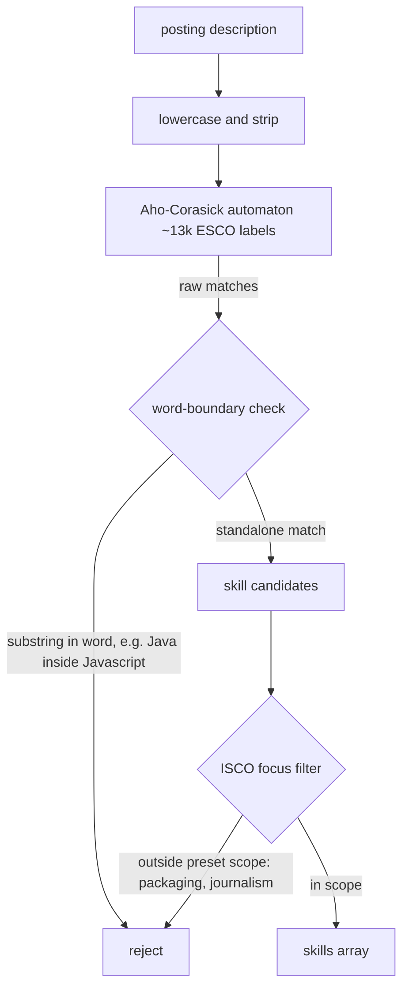

# Methodology & Docs

How the data gets here, how the taggers work, and the architecture decisions that shaped it.

## End-to-end data flow

From Adzuna's API to your browser, no backend:

```mermaid
flowchart LR
  A[Adzuna API] -->|JSON pages| B[ingest adapter]
  B -->|raw rows| C[normalise.run PostingSchema v3 incl work_arrangement tagger]
  C -->|EUR-normalised salaries| D[isco_tagger rapidfuzz cutoff 85]
  D -->|plus isco_code| E[skills_tagger ESCO Pillar B Aho-Corasick]
  E -->|plus skills| F[(parquet flat layout)]
  F -->|gh release upload| G[GitHub Releases latest preset parquet]
  G -->|FileAttachment| H[SQLite WASM browser]
  H --> I[Observable Plot]
```



A weekly cron in GitHub Actions runs the pipeline; the dashboard is rebuilt and pushed to GitHub Pages by `deploy-pages`. No server, no API key in the browser.

The dashboard itself is nine pages (Overview, Trends, Salary Distribution, Geography, Work Arrangement, Skills &amp; Roles, Compare Periods, Quality &amp; Coverage, and this one). Overview and Trends open with a market-pulse strip that compares the latest <em>complete</em> week (or month) with the one before; the still-filling current bucket is excluded so both pages report the same figures. Every data page shares the same sticky filter card — preset, country, ISCO group, work arrangement, salary range, date range — persisted in the URL so selections carry across pages, and ends with a table of the current selection with one-click CSV export. Salary Distribution draws every posting with a salary as a dot (coloured by whether the ad stated the salary or Adzuna estimated it — see below) under a density curve and above a box plot; it uses a chip-style version of the same filters and adds skill chips — a posting must mention every selected skill. Compare Periods is the exception: it replaces the shared filter card with its own two period selectors, since its charts contrast two time slices rather than one filtered view, and it has no export table.

## How salaries are handled

Every salary on this site is an **annual figure in euros**: the midpoint of the minimum and maximum Adzuna reports for the posting, converted at European Central Bank reference rates.

There are two kinds, and they should not be read the same way:

- **Stated in ad** — the employer put a salary or salary range in the posting.
- **Estimated by Adzuna** — the posting gave no salary. Adzuna, the job board this data comes from, predicts one from similar ads and flags it as predicted. The data column is called `salary_imputed`, which is why older text on this site says "imputed". An estimate describes what comparable jobs pay, not what this employer offered.

Roughly four in ten salaries here are estimates. The Salary Distribution page colours the two kinds differently and can leave the estimates out; Quality &amp; Coverage reports the current share. Elsewhere, medians and "with salary" counts include both.

**Salary floor.** Adzuna reports a minimum and maximum without saying what period they cover, and the pipeline treats every figure as annual. Ads that quote a day rate, an hourly rate or a monthly salary therefore arrive looking like annual salaries of a few euros to a few thousand. The pay period cannot be recovered reliably, so any salary below **€10,000 a year** is treated as *not stated*: the posting stays in every count and chart, only its salary is dropped. The floor is the preset setting `normalise.salary_floor_eur`; it is applied when postings are ingested and again each time the accumulated dataset is rebuilt, so earlier weeks are cleaned too. When it was introduced it removed 38 of 4,409 salaries — all under €3,600, with nothing else below €12,400.

Two limits remain. A mislabelled figure above the floor (a very high monthly salary, say) still gets through. And when Adzuna reports a minimum of zero, the midpoint is half the maximum, which understates the salary.

## ESCO skills tagger

Free-text job descriptions are scanned for skills using an Aho-Corasick automaton built from the ESCO Pillar B vocabulary, then scoped to the preset's ISCO focus:



The word-boundary check fixes a known substring-match pitfall (e.g. `Java` matches inside `Javascript`). The ISCO-focus filter is what makes the tagger preset-aware — the same automaton serves all presets, but each preset's YAML `isco_focus` narrows the output to relevant skills.

## Preset YAML schema

A preset is the unit of pluggability. Anyone who forks the repo can define their own; the existing one is for EU data-analyst roles:

```yaml
# config/runs/data_analyst_eu.yaml (abridged)
preset_id: data_analyst_eu
isco_focus:            # scopes the ESCO skills tagger to the analytics family
  - "2511"  # Systems analysts
  - "2519"  # Software & applications developers/analysts NEC
  - "2521"  # Database designers and administrators
  - "2529"  # Database and network professionals NEC
  - "2421"  # Management and organization analysts
  - "2120"  # Mathematicians, actuaries and statisticians
  - "1330"  # ICT service managers
sources:
  adzuna:
    enabled: true
    countries: ["gb", "es"]   # active pair; 7-country EU expansion planned
    keywords: ["data analyst", "analytics engineer", "bi analyst"]
normalise:
  salary_floor_eur: 10000   # salaries below this are treated as not stated
publish:
  accumulate_window_days: 180
```

Fork-friendly by design — to spin up a `data_engineer_us` preset you copy the YAML, adjust queries + countries + `isco_focus`, and the cron will pick it up.

## Architecture decisions

Decision log lives at [`DECISIONS.md`](https://github.com/alex-wu/jobmarket_analyzer/blob/main/DECISIONS.md). One ADR per significant choice:

<div class="card">

| ADR | Title |
|---|---|
| 001 | Orchestration: GitHub Actions cron (not Dagster) |
| 002 | Frontend: Observable Framework (not Evidence.dev, not Streamlit) |
| 003 | Ingestion: API-first, no JobSpy |
| 004 | Storage + delivery: Parquet via GitHub Releases as CDN |
| 005 | Licence: Apache-2.0 |
| 006 | Occupation taxonomy: ESCO (ISCO-08), not O*NET/SOC |
| 007 | LLM optional, openai-compatible |
| 008 | Pluggable adapter pattern (sources + benchmarks) |
| 009 | Remotive excluded from ingest sources |
| 010 | ESCO label snapshot built by walking the ISCO concept tree |
| 011 | OECD SDMX adapter ships disabled (Cloudflare) |
| 012 | CSO PxStat 4-digit ISCO coarseness |
| 013 | HN Algolia + LLM client descoped from v1 |
| 014 | Local-only files excluded from the public repo |
| 015 | httpx credential redaction filter |
| 016 | GitHub Pages deploy via `actions/deploy-pages` |
| 017 | Scope cut to Adzuna-only post-v1 stabilisation |
| 018 | Weekly cadence + multi-country single-run |
| 019 | Multi-preset `latest-{preset_id}` release naming |
| 020 | Accumulated dataset via pure-function recompute |
| 021 | No per-country keyword translation table in v1 |
| 022 | PostingSchema v2 — persist 5 Adzuna fields + skills |
| 023 | Skill enrichment via ESCO Pillar B + Aho-Corasick |
| 024 | Filter state persistence via URL search params |
| 025 | PostingSchema v3 — work_arrangement, dead-weight column drop |
| 026 | Dashboard v2 — Europe choropleth, page consolidation, CSV export |
| 027 | Browser SQL engine — SQLite replaces DuckDB-WASM |
| 028 | Salary Distribution page + chip filter bar |
| 029 | Salary floor at ingestion and accumulation |

</div>

## Data gaps (deliberate)

The original spec called for `experience_level`, `work_arrangement`, and detailed `skills` extraction. Two of the three have shipped: `work_arrangement` (remote / hybrid / onsite) is inferred by a multilingual keyword tagger (ADR-025) and has its own page plus a global filter — with the dominant unclassified share shown honestly as <code>unknown</code>; ESCO `skills` (ADR-023) are surfaced as the top-skills chart on Skills &amp; Roles. Only `experience_level` remains unfilled — Adzuna's payload doesn't carry it, and we ship only fields we have rather than guessing.

## Why the data re-loads on every page

Observable Framework uses standard `<a href>` navigation, not SPA routing — clicking a sidebar link is a full HTTP page load. Each navigation opens a fresh SQLite (sql.js) client and re-fetches the database file. In practice this is cheap on revisits: the browser HTTP-caches the `.wasm` runtime (under 1 MB) and the `.db` file, and modern Chromium and Firefox cache compiled WebAssembly per-origin. First page hit pays the parse cost; subsequent pages (and refreshes) hit warm caches.

There is no in-memory hand-off between pages. SPA routing was considered and rejected — it would mean abandoning Framework's documented routing model. Filter state IS preserved across navigation via URL search params — see the address bar after touching any filter.

## In-browser SQL engine

Charts query a SQLite database in the browser (Framework's built-in `SQLiteDatabaseClient`, i.e. sql.js — SQLite compiled to a single WebAssembly file, no workers or extensions). The site build converts the release parquet into that database: a `postings` table plus a `posting_skills` table (one row per posting × skill), with timestamps stored as UTC text and week / month / quarter buckets pre-computed, so the browser only runs portable SQL. Medians use a small registered aggregate with the same linear-interpolation definition as before.

Queries run from JS cells (`db.query(string)`) rather than Framework's fenced SQL blocks because chart queries compose WHERE clauses from filter state (e.g. `${andClause(where)}`), and fenced blocks parameter-bind `${...}` interpolations rather than text-substituting them.

Earlier versions used DuckDB-WASM, which intermittently failed to load data in Chromium-based browsers on Windows (upstream <a href="https://github.com/duckdb/duckdb-wasm/issues/1658" target="_blank" rel="noopener">duckdb-wasm #1658</a>). The SQLite backend replaced it (ADR-027); every dashboard query was checked to return identical results, and the site is smoke-tested in both Chromium and Firefox.

## Tech stack

Observable Framework (shell + reactive runtime) · SQLite via sql.js (in-browser SQL) · Observable Plot (charts, stock marks only) · Pandera strict-mode (upstream `PostingSchema` validation) · GitHub Actions (weekly cron + pages deploy) · `@duckdb/node-api` + `node:sqlite` (build-time parquet → SQLite loader).

## Refresh the local sample

```bash
gh release download latest-data_analyst_eu \
  -p "latest-data_analyst_eu.parquet" -p "manifest.json" \
  -R alex-wu/jobmarket_analyzer \
  -D data/gh_databuild_samples/ --clobber
```
